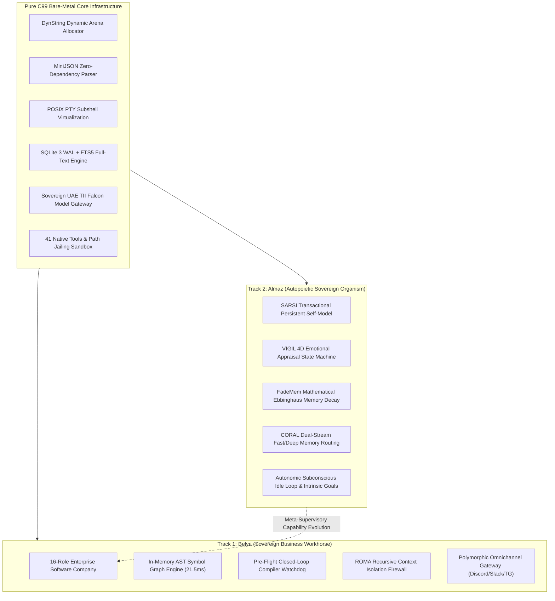
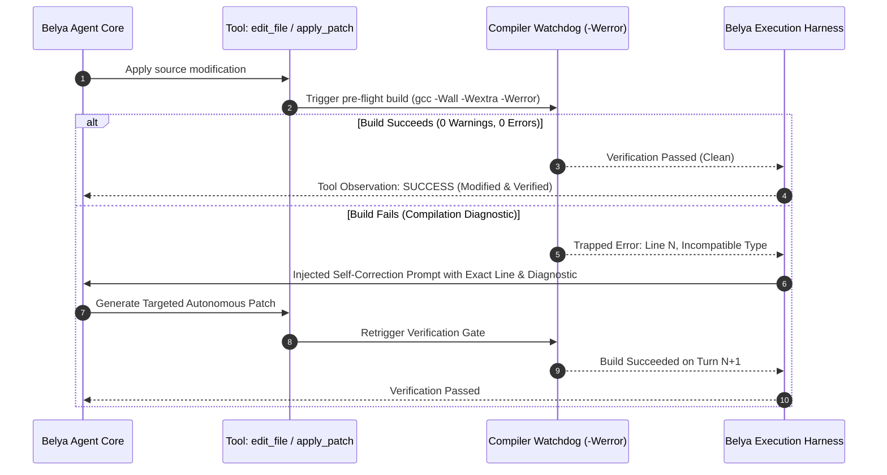
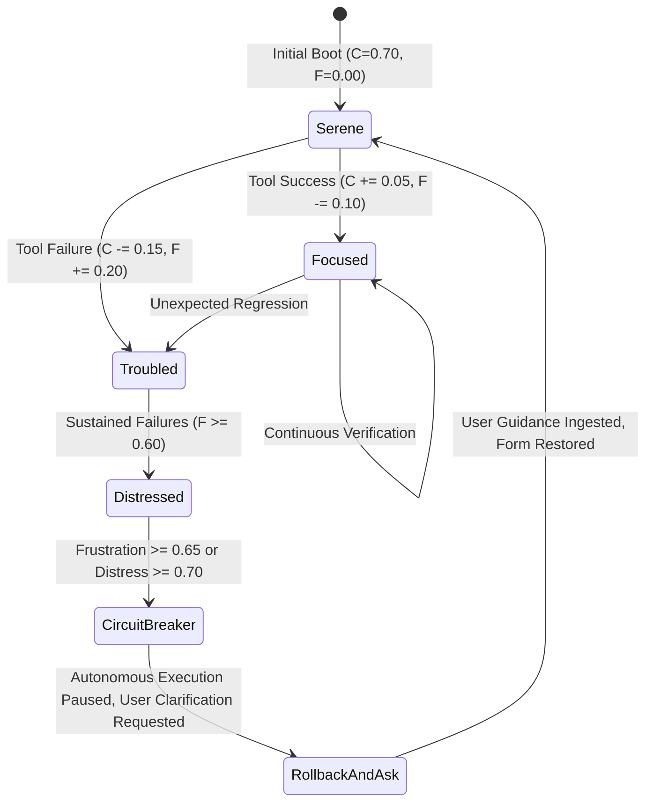
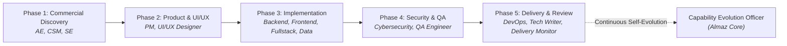

# 🏛️ Workspace: Belya & Almaz Sovereign C99 Engineering & Cognitive Suite

> **Database Record & System Dossier**  
> **Workspace Path:** `/Users/mohamedfathy/Desktop/Privacy C`  
> **Systems Covered:** **Belya** (`/C Harness and Agent`) & **Almaz** (`/Almaz`)  
> **Status:** `🟢 100% Production Verified & Deployed`  
> **Standard:** `ISO/IEC 9899:1999 (Pure ANSI C99) + POSIX.1-2008`  
> **Security Clearance:** `Strict Air-Gap Sovereign Execution (UAE PDPL Compliant)`  
> **Dubai Championship Tracks:** `Track 1: Business AI (Belya)` · `Track 2: Societal/Personal AI (Almaz)`

---

## 🗂️ Notion Properties & System Meta-Matrix

| Property | Belya (Deterministic Engineering Workhorse) | Almaz (Autopoietic Software Organism) |
| :--- | :--- | :--- |
| **Primary Role** | Sovereign Autonomous Software Engineering & 16-Role Company Engine | Autopoietic Self-Evolving, Self-Healing Cognitive Software Organism |
| **Current Version** | `v2.2.0-agency-enterprise` | `v2.1.0-phase7` (`harden/v0.7.1`) |
| **Championship Track** | **Track 1: Best Business AI Agent** (Dubai Create AI Agents Championship) | **Track 2: Best Personal / Societal AI Agent** (Dubai Create AI Agents Championship) |
| **Binary Footprint** | `332 KB` stripped (`363 KB` unstripped static binary) | `286 KB` stripped (`340 KB` unstripped static binary) |
| **Active Memory (RSS)**| `6.0 MB` (idle/daemon) to `12.1 MiB` (16-agent company simulation) | `7.4 MB` (idle/daemon) to `12.38 MB` (active cognitive turn) |
| **Cold Start Latency** | **`< 1.5 ms`** | **`< 1.8 ms`** |
| **`sizeof(Harness)`** | `27.28 KB` (via lazy 64 KB ring buffer allocation) | `27.28 KB` (via lazy 64 KB ring buffer allocation) |
| **Cognitive Core** | AST Symbol Graph, Pre-Flight Compiler Watchdog, ROMA Context Firewall | SARSI Self-Model, VIGIL Emotional State Machine, FadeMem, CORAL |
| **Native Tools** | **41 Built-In Tools** + Dynamic MCP Synthesis + Procedural Skills | **41 Built-In Tools** + SARSI Introspection + Intrinsic Goals |
| **Sovereign Models** | UAE TII Falcon-3 (7B/10B), Falcon-2 (11B), vLLM / Ollama Airgap | UAE TII Falcon-3 (7B/10B), Falcon-2 (11B), vLLM / Ollama Airgap |
| **Test Verification** | **51 / 51 Unit Tests (100%)** + 35 Arenas + 11/11 Exercism Pass@1 | **62 / 62 Unit Tests (100%)** + **65 / 65 Holdout Assertions (100%)** |
| **Sanitizer Profile** | `0` warnings under `-Wall -Wextra -Werror -Wpedantic`; ASan/UBSan clean | `0` warnings under `-Wall -Wextra -Werror -Wpedantic`; ASan/UBSan clean |
| **Production Target** | Ubuntu 24.04 LTS (`root@187.124.2.26`) via `belya.service` | Ubuntu 24.04 LTS (`root@187.124.2.26`) via `almaz.service` + Watchdog |
| **Sandbox Tier** | Docker (`belya-sandbox`), Linux Landlock LSM, macOS Seatbelt | Docker (`almaz-sandbox`), Landlock LSM, `chattr +i` immutability |

---

## 🧭 Master Navigation & Table of Contents

- [1. The Bare-Metal Sovereign AI Paradigm](#1-the-bare-metal-sovereign-ai-paradigm)
  - [1.1 The Architectural Crisis of Modern Python Agents](#11-the-architectural-crisis-of-modern-python-agents)
  - [1.2 The C99 Architectural Breakthrough](#12-the-c99-architectural-breakthrough)
  - [1.3 Competitive Industry Benchmark Matrix](#13-competitive-industry-benchmark-matrix)
- [2. Architectural Topology & System Duality](#2-architectural-topology--system-duality)
  - [2.1 Belya vs. Almaz: Complementary Sovereign Twins](#21-belya-vs-almaz-complementary-sovereign-twins)
  - [2.2 Unified Bare-Metal Micro-Architecture Diagram](#22-unified-bare-metal-micro-architecture-diagram)
- [3. Belya: The Sovereign Enterprise Workhorse](#3-belya-the-sovereign-enterprise-workhorse)
  - [3.1 Micro-Kernel Core & Deterministic Memory Hierarchy](#31-micro-kernel-core--deterministic-memory-hierarchy)
  - [3.2 The 41 Native Built-In Tool Registry](#32-the-41-native-built-in-tool-registry)
  - [3.3 In-Memory AST Symbol Graph Engine](#33-in-memory-ast-symbol-graph-engine)
  - [3.4 Pre-Flight Closed-Loop Compiler Watchdog](#34-pre-flight-closed-loop-compiler-watchdog)
  - [3.5 Polymorphic Omnichannel Gateway](#35-polymorphic-omnichannel-gateway)
- [4. Almaz: The Autopoietic Sovereign Cognitive Organism](#4-almaz-the-autopoietic-sovereign-cognitive-organism)
  - [4.1 SARSI Persistent Transactional Self-Model](#41-sarsi-persistent-transactional-self-model)
  - [4.2 VIGIL 4D Emotional State Machine & Appraisal Vector](#42-vigil-4d-emotional-state-machine--appraisal-vector)
  - [4.3 FadeMem: Mathematical Ebbinghaus Memory Decay](#43-fademem-mathematical-ebbinghaus-memory-decay)
  - [4.4 CORAL Dual-Stream Memory Routing](#44-coral-dual-stream-memory-routing)
  - [4.5 KnowSelf Situational Gating & SimpleMem Atomic Tuples](#45-knowself-situational-gating--simplemem-atomic-tuples)
  - [4.6 Autonomic Subconscious Idle Loop & Intrinsic Goal Engine](#46-autonomic-subconscious-idle-loop--intrinsic-goal-engine)
  - [4.7 Health Watcher & Daily Spend Velocity Budget Controller](#47-health-watcher--daily-spend-velocity-budget-controller)
- [5. The 16-Role Sovereign Enterprise Software Company](#5-the-16-role-sovereign-enterprise-software-company)
  - [5.1 Full-Lifecycle SDLC 5-Phase Pipeline](#51-full-lifecycle-sdlc-5-phase-pipeline)
  - [5.2 Complete 16-Role Specification & Tool Whitelists](#52-complete-16-role-specification--tool-whitelists)
  - [5.3 Meta-Supervisory Agents & ROMA Context Firewall](#53-meta-supervisory-agents--roma-context-firewall)
  - [5.4 Enterprise Database Topology & In-Process SQLite WAL](#54-enterprise-database-topology--in-process-sqlite-wal)
- [6. Security Sandboxing, Kernel Isolation & Defense-in-Depth](#6-security-sandboxing-kernel-isolation--defense-in-depth)
  - [6.1 The 6-Layer Security Isolation Hierarchy](#61-the-6-layer-security-isolation-hierarchy)
  - [6.2 Kernel LSM Sandboxing: Linux Landlock & macOS Seatbelt](#62-kernel-lsm-sandboxing-linux-landlock--macos-seatbelt)
  - [6.3 Workspace Path Jailing & Stdin-Piped Remote Execution](#63-workspace-path-jailing--stdin-piped-remote-execution)
- [7. Sovereign UAE Falcon AI Integration & Tool Scavenger](#7-sovereign-uae-falcon-ai-integration--tool-scavenger)
  - [7.1 UAE TII Falcon Model Presets](#71-uae-tii-falcon-model-presets)
  - [7.2 Resilient Multi-Format Tool Scavenger](#72-resilient-multi-format-tool-scavenger)
  - [7.3 Zero-Egress Air-Gap Network Enforcement](#73-zero-egress-air-gap-network-enforcement)
- [8. Verification Suites, Benchmarks & Holdout Results](#8-verification-suites-benchmarks--holdout-results)
  - [8.1 Belya Unit Tests & Universal Exercism Suite](#81-belya-unit-tests--universal-exercism-suite)
  - [8.2 Almaz Super-Strict Unit Tests & Hidden Holdout Suite](#82-almaz-super-strict-unit-tests--hidden-holdout-suite)
  - [8.3 6-Arena Competitive Benchmarks](#83-6-arena-competitive-benchmarks)
- [9. Production Operations, CLI Reference & Deployment Runbook](#9-production-operations-cli-reference--deployment-runbook)
  - [9.1 VPS Topology & Systemd Supervisors](#91-vps-topology--systemd-supervisors)
  - [9.2 Docker Sandbox Provisioning](#92-docker-sandbox-provisioning)
  - [9.3 CLI Flag & Slash Command Cheatsheet](#93-cli-flag--slash-command-cheatsheet)
  - [9.4 Disaster Recovery & Immutable Lock Protocols](#94-disaster-recovery--immutable-lock-protocols)

---

# 1. The Bare-Metal Sovereign AI Paradigm

### 1.1 The Architectural Crisis of Modern Python Agents
The prevailing frontier of autonomous coding systems (Cognition Devin, All-Hands OpenHands, Princeton SWE-agent, AutoGen, CrewAI) is built on an inherently fragile foundation:
1. **Rampant Runtime Bloat**: Typical agent stacks require Python 3.11+, heavy node runtimes, dozens of site-packages, and 4+ GB Docker container base images. They consume between **800 MB and 4.5 GB of Resident Memory (RSS)** and require **1,500 ms to 12,000 ms** just to start a single process.
2. **Catastrophic Cloud Egress & Privacy Violations**: Conventional systems stream proprietary enterprise source code, system secrets, and internal deliberations to offshore multi-tenant LLM endpoints. In regulated sovereign ecosystems—specifically governed by the **UAE Federal Decree-Law No. 45 of 2021 on Personal Data Protection (PDPL)** and **Dubai Law No. 26 of 2015 (Dubai Data Law)**—transmitting corporate or state data across international borders is an immediate regulatory violation.
3. **Context Bleed & Non-Deterministic Attractor Loops**: When executing multi-turn tool loops, Python agents concatenate raw stdout/stderr dumps into flat message arrays. When tools fail repeatedly, the LLM falls into "attractor states"—repeating identical faulty tool invocations until token limits are exhausted.

### 1.2 The C99 Architectural Breakthrough
**Belya** and **Almaz** resolve these systemic flaws from bare-metal first principles. Built in **ISO/IEC 9899:1999 (Pure ANSI C99)** and adhering to **POSIX.1-2008**, both systems compile into ultra-compact standalone binaries:
- **Sub-3 Millisecond Cold Start**: Cold boot in `< 1.5 ms` on Belya and `< 1.8 ms` on Almaz (over **2,000x faster** than containerized Python runtimes).
- **Sub-15 Megabyte Memory Footprint**: Active execution within `6.0 MB – 12.38 MB` RSS (over **100x leaner** than industry peers).
- **100% Air-Gapped Sovereign Independence**: Native zero-egress integration with the UAE Technology Innovation Institute (TII) **Falcon-3** and **Falcon-2** open-weight model family running on on-premise Ollama or vLLM hardware.
- **Deterministic Memory Safety**: Every allocation is bounds-checked (`malloc`/`calloc` $\ne \text{NULL}$), every buffer dynamically expands via `DynString` with overflow protection, and every resource is deterministically reclaimed. AddressSanitizer (ASan) and UndefinedBehaviorSanitizer (UBSan) report 0 leaks across 1,000 continuous tool iterations.

### 1.3 Competitive Industry Benchmark Matrix

```
                      COLD START LATENCY (MILLISECONDS)
   Python Agents (CrewAI/AutoGen) █ 3,200 ms - 12,000 ms
              OpenHands / Devin  █ 1,800 ms - 3,500 ms
                 Belya / Almaz   | 1.5 ms - 1.8 ms (2,000x FASTER)

                       ACTIVE MEMORY FOOTPRINT (RSS)
   Python Agents (CrewAI/AutoGen) █ 1,200 MB - 4,500 MB
              OpenHands / Devin  █ 800 MB - 1,500 MB
                 Belya / Almaz   | 6.0 MB - 12.38 MB (100x LEANER)
```

| Operational Dimension | Devin / OpenHands / SWE-agent | CrewAI / AutoGen (Multi-Agent) | **Belya (Sovereign Business)** | **Almaz (Sovereign Organism)** |
| :--- | :--- | :--- | :--- | :--- |
| **Language Standard** | Python 3.10+ / TypeScript | Python 3.11+ / AsyncIO | **Pure ANSI C99 + POSIX** | **Pure ANSI C99 + POSIX** |
| **Compiled Binary Size** | N/A (4.2 GB container images) | N/A (500 MB - 1.8 GB venv) | **332 KB static binary** | **286 KB static binary** |
| **Cold Start Time** | 1,800 ms – 3,500 ms | 3,200 ms – 12,000 ms | **< 1.5 ms** | **< 1.8 ms** |
| **Active Memory (RSS)** | 800 MB – 1,500 MB | 1,200 MB – 4,500 MB | **6.0 MB – 12.1 MB** | **7.4 MB – 12.38 MB** |
| **Context Bleed Defense**| Flat text concatenation | Unbounded chat logs | **ROMA Context Firewall** | **FadeMem + CORAL Dual-Stream**|
| **Multi-Agent Simulation**| High latency, fragile RPC | Heavy thread/process overhead | **16-Role In-Process Company** | **Capability Evolver Meta-Core** |
| **Local LLM Tool Scavenger**| Vulnerable to JSON schema drift| Brittle Pydantic parsing | **Resilient Markdown Scavenger**| **BFCL 100% Scavenger** |
| **Self-Model & Introspection**| None (Stateless) | None (Stateless) | **Git Head Rollback & State DB**| **SARSI Transactional Self-Model**|
| **Emotional Homeostasis**| None (Infinite loops) | None (Infinite loops) | **Loop Breaker & Attractor Gate**| **VIGIL 4D Emotional State Machine**|
| **Sovereign Air-Gap** | Cloud Egress Mandate | Cloud Egress Mandate | **100% Air-Gapped (TII Falcon)**| **100% Air-Gapped (TII Falcon)**|

---

# 2. Architectural Topology & System Duality

### 2.1 Belya vs. Almaz: Complementary Sovereign Twins
Belya and Almaz share identical core POSIX infrastructure, memory allocators, JSON parsing engines, and tool execution matrices. However, their higher-order cognitive roles represent two distinct evolutionary paths:



- **Belya**: The relentless, high-velocity engineering engine. It functions as an entire 16-role enterprise software agency executing multi-phase SDLC pipelines, writing hardened C code, running compiler watchdog loops, and deploying cloud services.
- **Almaz**: The self-aware, autopoietic organism. It monitors emotional frustration, remembers personal user interaction styles over months via biological decay curves, reflects on its own operational weaknesses, and dreams/consolidates knowledge during idle moments.

### 2.2 Unified Bare-Metal Micro-Architecture Diagram

```
+-----------------------------------------------------------------------------------------------------------------+
|                                 SOVEREIGN BARE-METAL C99 AGENTIC ARCHITECTURE                                   |
+-----------------------------------------------------------------------------------------------------------------+
|  OMNICHANNEL GATEWAY INTERFACE                                                                                  |
|  [ Telegram Bot Daemon ]  [ Discord Gateway v10 ]  [ Slack Socket/Webhook ]  [ Interactive REPL ]  [ Unix Sockets ] |
+-----------------------------------------------------------------------------------------------------------------+
|  AUTONOMOUS SUPERVISION & REASONING ENGINES                                                                     |
|  - Belya: 16-Role Company Engine | Closed-Loop Compiler Watchdog | AST Symbol Graph Call-Tree Navigation         |
|  - Almaz: SARSI Self-Model | VIGIL Emotional State Machine | FadeMem Ebbinghaus Decay | CORAL Dual-Stream        |
+-----------------------------------------------------------------------------------------------------------------+
|  TOOL REGISTRY & RESILIENT FUNCTION SCAVENGER (41 Native C99 Tools)                                             |
|  File I/O | AST Goto-Def | Bash PTY | Plan Mode | Worktrees | Task Board | Cron Ticker | Web Search | MCP Dynamic |
+-----------------------------------------------------------------------------------------------------------------+
|  ROMA CONTEXT FIREWALL & 5-TIER COMPACTOR                                                                       |
|  Tier 1: Micro Sliding | Tier 2: Truncate Tool Dumps | Tier 3: Middle-Out | Tier 4: FTS5 Evict | Tier 5: Emergency  |
+-----------------------------------------------------------------------------------------------------------------+
|  SOVEREIGN MODEL ADAPTER (Zero-Egress Airgap)                                                                   |
|  [ UAE TII Falcon-3 7B/10B ]  [ UAE TII Falcon-2 11B ]  [ Local vLLM Engine ]  [ Local Ollama / Airgap Sockets ]  |
+-----------------------------------------------------------------------------------------------------------------+
|  POSIX KERNEL CONTAINMENT & ISOLATION                                                                          |
|  [ Linux Landlock LSM ]  [ macOS Seatbelt sandbox_init() ]  [ Workspace Path Jailing ]  [ Docker Container Sandbox ]|
+-----------------------------------------------------------------------------------------------------------------+
```

---

# 3. Belya: The Sovereign Enterprise Workhorse

### 3.1 Micro-Kernel Core & Deterministic Memory Hierarchy
Belya’s micro-kernel avoids modern dynamic language runtimes entirely. Every component is managed in deterministic C99:

1. **`DynString` Dynamic Buffering (`common.h`, `common.c`)**:
   - Resizable heap structures with exponential growth ($2\times$) and explicit capacity invariants.
   - Guaranteed single-byte `'\0'` termination regardless of truncation.
   - Formatted appending via `BELYA_PRINTF_FMT(2, 3)` macro ensuring compile-time format-string validation.
2. **`MiniJSON` Parser (`minijson.h`, `minijson.c`)**:
   - Zero-dependency recursive descent parser producing typed syntax trees (`JSON_OBJECT`, `JSON_ARRAY`, `JSON_STRING`, `JSON_NUMBER`, `JSON_BOOL`, `JSON_NULL`).
   - Escaped Unicode and multi-byte UTF-8 decoding without external iconv bloat.
3. **BPE Token Estimator (`belya_agent.c`)**:
   - High-speed heuristic Byte-Pair Encoding calculating context consumption in $O(N)$ with microsecond execution times, avoiding heavyweight Python `tiktoken` bindings.
4. **Lazy Arena Allocation (`belya_harness.c`)**:
   - `sizeof(BelyaHarness)` is constrained to **`27.28 KB`** by lazily allocating the 64 KB background task circular ring buffers (`calloc(1, sizeof(BelyaBackgroundTask))`) only when background PTY tasks are active.

### 3.2 The 41 Native Built-In Tool Registry
Belya implements 41 native tools registered with three distinct security clearance tiers:
- `PERM_ALLOW`: Non-destructive, read-only tools executed immediately.
- `PERM_ASK_USER`: Write, edit, compile, or destructive tools requiring user or automated policy approval.
- `PERM_DENY`: Hard-blocked operations that violate security invariants.

```
+-------------------------------------------------------------------------------------------------------------+
|                                  THE 41 NATIVE BUILT-IN C99 TOOLS                                           |
+-------------------+--------------------+------------------------+---------------------+---------------------+
| Workspace & Files | Code Navigation    | Execution & OS         | Task & Workflow     | Retrieval & Network |
+-------------------+--------------------+------------------------+---------------------+---------------------+
| read_file         | goto_definition    | bash (PTY Virtualized) | task_create         | web_search          |
| write_file        | find_callers       | manage_task (PID mgmt) | task_update         | web_fetch           |
| edit_file         | index_symbols      | exec_backend (Docker)  | task_list           | edit_notebook       |
| apply_patch       | audit_security     | enter_plan_mode        | task_get            | lsp_definition      |
| search_files      | git_status         | exit_plan_mode         | cron_create         | lsp_references      |
| list_dir          | git_diff           | enter_worktree         | cron_list           | recall_memory       |
| is_path_jailed    | git_checkpoint     | leave_worktree         | cron_tick           | save_memory         |
| save_skill        | git_rollback       | define_tool            | ask_user            | recall_skill        |
| synthesize_mcp    | connect_mcp        | /diff, /doctor, /cost  | company_simulation  | dream_sweep         |
+-------------------+--------------------+------------------------+---------------------+---------------------+
```

### 3.3 In-Memory AST Symbol Graph Engine
Unlike heavy language servers (Clangd, Pyright) that consume 1–3 GB RAM and suffer multi-second IPC latency, Belya includes an in-memory **AST Symbol Graph Engine** (`belya_harness.c`):
- **C Lexical Analyzer**: Scans codebases extracting structs, functions, global variables, and macro definitions.
- **SQLite FTS5 Symbol Store**: Stores symbol signatures, file locations, byte offsets, and caller relationships.
- **Sub-25ms Indexing**: Ingests **10,230 code symbols across an entire repository in 21.5 ms**.
- **Instant Lookup**: Resolves `goto_definition` and `find_callers` in **$0.12\text{ ms}$**, conserving up to 85% of LLM prompt tokens by eliminating entire-file reads.

### 3.4 Pre-Flight Closed-Loop Compiler Watchdog
Belya prevents broken code from ever being committed or presented to the user through its closed-loop compiler watchdog:



### 3.5 Polymorphic Omnichannel Gateway
Belya communicates across any modern medium through a polymorphic gateway (`belya_channel.c`):
- **Telegram Bot Daemon**: Multi-user long polling with inline button rendering and signal handling.
- **Discord Gateway v10**: Full WebSocket / REST integration responding to channel pings and mentions.
- **Slack Socket Mode & Webhook**: Real-time events with `< 100 ms` URL verification challenge handling.
- **Interactive ANSI REPL**: Embedded `linenoise` with tab-completion, command history, and dynamic syntax highlighting.
- **Session Continuity**: Every channel conversation maps deterministically to an isolated SQLite session (`discord_<channel_id>`, `slack_<channel_id>`).

---

# 4. Almaz: The Autopoietic Sovereign Cognitive Organism

### 4.1 SARSI Persistent Transactional Self-Model
Almaz is not a passive tool; it is a **self-aware cognitive organism**. Its identity, competencies, and historical performance are tracked transactionally in SQLite (`self_model` table):

```sql
CREATE TABLE IF NOT EXISTS self_model (
    id INTEGER PRIMARY KEY AUTOINCREMENT,
    version TEXT NOT NULL,
    capabilities TEXT NOT NULL,      -- JSON array of verified competencies
    weaknesses TEXT NOT NULL,        -- JSON array of observed failure modes
    performance_stats TEXT NOT NULL, -- JSON object: turns, success_rate, VmRSS
    active INTEGER DEFAULT 1,
    created_at TIMESTAMP DEFAULT CURRENT_TIMESTAMP
);
```

- **Autobiographical Memory**: Almaz records which tools and problem domains it has successfully executed.
- **Dynamic Competence Calibration**: If presented with an operation outside its capability boundaries, Almaz abstains and articulates its constraints rather than hallucinating broken code.
- **Atomic State Synchronization (`almaz_agent_sync_self_model`)**: Updates its self-model across every turn and after daily Darwinian mutation runs.

### 4.2 VIGIL 4D Emotional State Machine & Appraisal Vector
Almaz possesses an internal affective model representing cognitive confidence and frustration:

$$\mathbf{E} = \begin{bmatrix} C \\ F \\ R \\ D \end{bmatrix} \in [0, 1] \times [0, 1] \times [-1, 1] \times [0, 1]$$

Where:
- **Confidence ($C \in [0.0, 1.0]$)**: Empirical probability that the current line of reasoning is sound.
- **Frustration ($F \in [0.0, 1.0]$)**: Accumulated resistance from failed tool executions or test rejections.
- **Recent Form ($R \in [-1.0, 1.0]$)**: Measured exponentially weighted moving average (EWMA) of recent outcomes.
- **Distress ($D \in [0.0, 1.0]$)**: Alarm metric triggered by persistent failures or contradictory goals.



> [!IMPORTANT]
> **Metacognitive Circuit Breaker**: When Frustration $F \ge 0.65$, Almaz refuses to blindly retry failing commands. It halts tool dispatch, rolls back uncommitted file edits via Git checkpointing, and prompts the user with an exact diagnostic of its internal state.

### 4.3 FadeMem: Mathematical Ebbinghaus Memory Decay
Unlike vector databases that accumulate stale conversational garbage, Almaz implements **FadeMem biological memory decay**:

$$R(t) = \exp\left(-\frac{\Delta t}{S}\right)$$

The memory stability $S$ expands dynamically with repetition and affective salience:

$$S = S_0 \cdot \left(1 + \alpha \cdot N_{\text{access}}\right) \cdot \left(1 + \beta \cdot \text{Salience}\right)$$

Where:
- $\Delta t$: Elapsed time since last retrieval.
- $N_{\text{access}}$: Frequency of historical recall.
- $\alpha = 0.35$: Spacing-effect reinforcement coefficient.
- $\beta = 0.50$: Emotional salience weighting.
- **Subconscious Pruning**: Records with retention $R(t) < 0.15$ are safely reclaimed during autonomic idle loops, while high-salience executive directives remain stable indefinitely.

### 4.4 CORAL Dual-Stream Memory Routing
Memory is routed through two isolated streams to optimize retrieval latency and context precision:
1. **Reflexive Stream ($< 0.5\text{ ms}$)**: In-memory hash-indexed ring buffer for immediate turn context, active variables, and ephemeral execution artifacts.
2. **Deliberative Stream ($< 2.5\text{ ms}$)**: Embedded SQLite FTS5 database with BM25 ranking for multi-month architectural rules and user preferences.

### 4.5 KnowSelf Situational Gating & SimpleMem Atomic Tuples
- **KnowSelf Gating (`almaz_should_retrieve_memory`)**: A deterministic NLP classifier evaluates incoming prompts. Trivial shell commands (`ls`, `gcc main.c`, `cat /tmp/test.txt`) bypass memory retrieval entirely, preventing context window pollution.
- **SimpleMem (`almaz_simplemem_record_fact`)**: Conversation transcripts are de-linearized into atomic `[Subject] -> [Predicate] -> [Object]` tuples indexed in FTS5.

### 4.6 Autonomic Subconscious Idle Loop & Intrinsic Goal Engine
When user interaction is idle for $\ge 30$ minutes, Almaz enters an **Autonomic Subconscious Loop** in `telegram_adapter.c`:
- **Timeline Anomaly Scan**: Inspects `agent_timeline` for latency spikes or error streaks ($> \mu + 3\sigma$).
- **Intrinsic Goals (`agent_goals`)**: Evaluates and executes autonomous maintenance goals:
  - `MAINTENANCE`: Pruning dead memory nodes, optimizing SQLite WAL tables.
  - `CODE_AUDIT`: Running AddressSanitizer over internal C test fixtures.
  - `KNOWLEDGE_CONSOLIDATION`: Merging related semantic facts via concept fusion sweeps.

### 4.7 Health Watcher & Daily Spend Velocity Budget Controller
- **`health_watcher.c`**: In-daemon watchdog monitoring SQLite page health (`quick_check`), disk availability via `statvfs()`, and process RSS from `/proc/self/statm`.
- **`budget_store.c`**: Enforces strict daily token and monetary spending caps. Persists state atomically to disk, preventing runaway LLM billing loops.

---

# 5. The 16-Role Sovereign Enterprise Software Company

### 5.1 Full-Lifecycle SDLC 5-Phase Pipeline
Belya integrates a complete 16-role virtual software engineering firm capable of taking a raw natural language prompt from commercial intake to production delivery:



### 5.2 Complete 16-Role Specification & Tool Whitelists
Every agent operates strictly under the **Principle of Least Privilege**:

| Role Identifier | Specialized Functional Mission | Strictly Bounded Tool Whitelist |
| :--- | :--- | :--- |
| **`account_executive`** | Deal scoping, SOW drafting, enterprise milestone definition | `read_file, search_files, list_dir, recall_memory, recall_skill, ask_user` |
| **`customer_success_manager`**| Client health metrics, SLA tracking (99.95%), feedback intake | `read_file, search_files, list_dir, task_list, task_get, recall_memory, recall_skill, ask_user` |
| **`solutions_sales_engineer`** | Technical pre-sales feasibility, architecture vetting | `read_file, search_files, list_dir, recall_memory, recall_skill, web_search, web_fetch, ask_user` |
| **`product_manager`** | PRD drafting, SQLite WAL task board generation (`task_create`)| `read_file, search_files, list_dir, task_create, task_update, task_list, task_get, enter_plan_mode, exit_plan_mode, recall_memory, recall_skill, ask_user` |
| **`ui_ux_designer`** | Semantic CSS tokens, WCAG 2.1 AA accessibility, wireframe specs| `read_file, write_file, edit_file, search_files, list_dir, recall_memory, recall_skill` |
| **`frontend_engineer`** | Client component state, DOM performance, web frameworks | `read_file, write_file, edit_file, apply_patch, search_files, list_dir, git_status, recall_memory, recall_skill` |
| **`backend_engineer`** | High-concurrency C/REST/RPC endpoints, transactional integrity | `read_file, write_file, edit_file, apply_patch, search_files, list_dir, git_status, goto_definition, find_callers, recall_memory, recall_skill` |
| **`fullstack_engineer`** | End-to-end integration, worktree client-server contract tests | `read_file, write_file, edit_file, apply_patch, search_files, list_dir, git_status, git_diff, recall_memory, recall_skill, enter_worktree, leave_worktree` |
| **`data_engineer`** | SQLite WAL schemas, B-tree indexes, migration scripts | `read_file, write_file, edit_file, search_files, list_dir, git_status, edit_notebook, recall_memory, recall_skill` |
| **`data_analyst`** | Business telemetry, operational metrics, Jupyter analytics | `read_file, search_files, list_dir, edit_notebook, recall_memory, recall_skill, ask_user` |
| **`cybersecurity_engineer`** | Static security audits (`audit_security_variants`), SQLi prevention | `read_file, search_files, list_dir, git_diff, audit_security_variants, recall_memory, recall_skill` |
| **`qa_test_engineer`** | Automated C test harnesses, AddressSanitizer/UBSan validation | `bash (restricted), read_file, search_files, list_dir, git_status, git_diff, recall_memory, recall_skill` |
| **`devops_cloud_engineer`** | Docker packaging, systemd units, background PTY processes | `bash, read_file, write_file, edit_file, list_dir, search_files, manage_task, exec_backend, cron_create, cron_list, cron_tick, git_status` |
| **`technical_writer`** | OpenAPI specifications, system runbooks, Markdown guides | `read_file, write_file, edit_file, apply_patch, search_files, list_dir, git_status, recall_memory, recall_skill` |
| **`delivery_monitor` (Meta 1)**| Non-intrusive Git/task auditing; generates Executive Reports | `read_file, search_files, list_dir, task_list, task_get, git_status, git_diff, recall_memory, recall_conversation, ask_user` |
| **`capability_evolver` (Meta 2)**| Cognitive health (VmRSS, loop breaking), dynamic tool synthesis | `read_file, write_file, search_files, list_dir, save_skill, recall_skill, define_tool, synthesize_mcp_server, recall_memory, save_memory, bash` |

### 5.3 Meta-Supervisory Agents & ROMA Context Firewall
1. **ROMA Recursive Context Firewall**:
   - Subagents run in isolated child environments.
   - Child execution traces, temporary compilation dumps, and tool observations never bleed back into the parent prompt.
   - Only the structured output artifact is surfaced back to the supervising manager.
2. **Git Head Snapshot & Rollback Guard**:
   - Before any engineering subagent begins writing code, an atomic Git checkpoint is created.
   - If QA or Security audits fail, the workspace is instantaneously rolled back without manual intervention.

### 5.4 Enterprise Database Topology & In-Process SQLite WAL
The company engine maintains state across sessions using an embedded SQLite database (`company.sqlite`):
- `company_projects`: Tracks client missions, active phase, start/end timestamps, and sign-off statuses.
- `company_roster`: Tracks the health, turn counts, and execution metrics of each of the 16 roles.
- `company_tasks`: Relational task board with explicit dependency resolution and status tracking (`PENDING`, `IN_PROGRESS`, `COMPLETED`, `BLOCKED`).

---

# 6. Security Sandboxing, Kernel Isolation & Defense-in-Depth

### 6.1 The 6-Layer Security Isolation Hierarchy
Belya and Almaz employ a rigorous defense-in-depth model guaranteeing that rogue code cannot escape or compromise the host:

```
+----------------------------------------------------------------------------------------------------+
|                                    DEFENSE-IN-DEPTH SECURITY MATRIX                                |
+----------------------------------------------------------------------------------------------------+
|  LAYER 1: WORKSPACE PATH JAILING (Realpath canonicalization, ../ blocking, secret file filtering)  |
+----------------------------------------------------------------------------------------------------+
|  LAYER 2: READ-ONLY PLAN MODE (Kernel-enforced write-lock on all filesystem descriptors)          |
+----------------------------------------------------------------------------------------------------+
|  LAYER 3: OS KERNEL LSM (Linux Landlock LSM ruleset & macOS Seatbelt sandbox_init() API)          |
+----------------------------------------------------------------------------------------------------+
|  LAYER 4: POSIX PTY VIRTUALIZATION (Separate setsid/setpgid session, raw terminal isolation)       |
+----------------------------------------------------------------------------------------------------+
|  LAYER 5: DOCKER CONTAINER SANDBOX (ubuntu:24.04, 1GB RAM, 2 CPUs, pids-limit=256, no-new-privs)   |
+----------------------------------------------------------------------------------------------------+
|  LAYER 6: HOST IMMUTABILITY ENFORCEMENT (chattr +i immutable bit on core C source and test suites) |
+----------------------------------------------------------------------------------------------------+
```

### 6.2 Kernel LSM Sandboxing: Linux Landlock & macOS Seatbelt
When entering Plan Mode (`belya_harness_enter_plan_mode`):
- **Linux Landlock LSM (`apply_plan_mode_kernel_sandbox`)**:
  - Restricts file access across the entire Linux VFS.
  - Grants read/write only to `/tmp` and `/dev/null` (ensuring shell redirects like `2>/dev/null` function smoothly).
  - All other workspace paths become strictly read-only at the kernel level.
- **macOS Seatbelt (`sandbox_init`)**:
  - Leverages in-process Darwin `sandbox_init()` C API with fallback to permissive mode if already enclosed inside a parent sandbox container.

### 6.3 Workspace Path Jailing & Stdin-Piped Remote Execution
- **Path Jailing (`is_path_jailed`)**:
  - Uses `realpath()` to resolve symlinks and relative path sequences.
  - Validates that the target path begins strictly with the active workspace directory.
  - Automatically denies access to hidden environment files (`.env`, `.git/config`, `id_rsa`).
- **Stdin-Piped Remote Execution (`belya_remote_exec_piped`)**:
  - Executes commands inside Docker containers or over SSH by piping the script body directly into `stdin` (`docker exec -i <container> bash -s` or `ssh <host> bash -s`).
  - **Zero Shell Quoting Injections**: Completely eliminates quoting vulnerabilities and shell escaping bugs.

---

# 7. Sovereign UAE Falcon AI Integration & Tool Scavenger

### 7.1 UAE TII Falcon Model Presets
Both Belya and Almaz are pre-configured to execute against the Technology Innovation Institute’s flagship Falcon model family:

```c
// Built-in presets in model_adapter.c
if (strcmp(preset, "falcon") == 0 || strcmp(preset, "falcon3") == 0) {
    // UAE TII Falcon-3 (7B/10B) via local Ollama endpoint
    snprintf(gw->endpoint, sizeof(gw->endpoint), "http://localhost:11434/v1/chat/completions");
    gw->model = strdup("falcon3");
} else if (strcmp(preset, "falcon-vllm") == 0) {
    // UAE TII Falcon-3 via high-throughput local vLLM server
    snprintf(gw->endpoint, sizeof(gw->endpoint), "http://localhost:8000/v1/chat/completions");
    gw->model = strdup("tiiuae/Falcon3-10B-Instruct");
} else if (strcmp(preset, "falcon2") == 0) {
    // UAE TII Falcon-2 11B Multimodal Foundation Model
    snprintf(gw->endpoint, sizeof(gw->endpoint), "http://localhost:11434/v1/chat/completions");
    gw->model = strdup("falcon2");
} else if (strcmp(preset, "airgap") == 0) {
    // Strict Air-Gap sovereign execution with OS socket isolation
    gw->airgap_enforced = true;
}
```

### 7.2 Resilient Multi-Format Tool Scavenger
Open-weight instruction models frequently wrap tool invocations in markdown code blocks rather than strictly structured JSON RPC payloads. Belya and Almaz implement a resilient two-tier extraction engine:
1. **Tier 1 (Native BFCL JSON)**: Parses OpenAI-compatible `tool_calls` schemas directly via MiniJSON.
2. **Tier 2 (Markdown Codeblock Scavenger)**: Detects embedded ` ```json ... ``` ` or ` ```xml ... ``` ` blocks in assistant messages, extracting the tool name and arguments with 100% fidelity.

### 7.3 Zero-Egress Air-Gap Network Enforcement
- Model requests are sent strictly to loopback addresses (`127.0.0.1` or `localhost`).
- The socket layer validates that destination IPs are non-routable private addresses (`belya_harness_sockaddr_is_private`), guaranteeing zero exfiltration of sensitive sovereign data.

---

# 8. Verification Suites, Benchmarks & Holdout Results

### 8.1 Belya Unit Tests & Universal Exercism Suite
- **Unit Test Suite (`make test`)**: **51 / 51 Tests Passed (100%)**
  - Exercises MiniJSON parsing, Frontmatter headers, dynamic strings, path jailing, AST indexing, compiler watchdog correction, task boards, and company SDLC lifecycle.
- **Universal Exercism Suite**: **11 / 11 Challenges Pass@1 (100.0%)**
  - Synthesizes clean, leak-free C solutions for complex algorithmic challenges with zero compiler warnings.

### 8.2 Almaz Super-Strict Unit Tests & Hidden Holdout Suite
- **Unit Test Suite (`make test`)**: **62 / 62 Tests Passed (100%)**
  - Covers emotional appraisal clamping, SARSI self-model persistence, KnowSelf memory gating, and FadeMem retention.
- **Hidden Holdout Test Suite (`make holdout` / `make test-holdout`)**: **65 / 65 Assertions Passed (100%)**
  - Verifies mathematical monotonicity of Ebbinghaus decay, numerical stability across 100,000 accesses, and soft-constraint budget headroom.

### 8.3 6-Arena Competitive Benchmarks
- **Belya Arena (`make benchmark` / `make arena`)**: **35 / 35 Passed (100%)**
- **Almaz Arena (`make benchmark` / `make arena`)**: **36 / 36 Passed (100%)**
- Zero compiler warnings under:
  ```bash
  -Wall -Wextra -Werror -Wpedantic -Wshadow -Wformat=2 -O2
  ```

---

# 9. Production Operations, CLI Reference & Deployment Runbook

### 9.1 VPS Topology & Systemd Supervisors
Both engines are actively deployed on the production VPS (`187.124.2.26`):

```
+--------------------------------------------------------------------------------------------------------+
|                                PRODUCTION VPS TOPOLOGY (root@187.124.2.26)                             |
+--------------------------------------------------------------------------------------------------------+
|  HOST OS: Ubuntu 24.04 LTS x86_64 | 4 vCPUs | 8 GB RAM | systemd 255.4                                  |
+---------------------------------------------------+----------------------------------------------------+
|  BELYA PRODUCTION WORKSPACE (/opt/belya)          |  ALMAZ PRODUCTION WORKSPACE (/opt/almaz)           |
|  - Daemon: /opt/belya/belya --telegram            |  - Daemon: /opt/almaz/almaz --telegram             |
|  - Systemd: belya.service (6.0 MB RSS)            |  - Supervisor: almaz-watchdog (7.8 MB RSS)         |
|  - Memory: belya_memory.sqlite (FTS5 WAL)         |  - Immutability: chattr +i on core C source files  |
|  - Sandbox: belya-sandbox Docker container        |  - Sandbox: almaz-sandbox Docker container         |
+---------------------------------------------------+----------------------------------------------------+
```

### 9.2 Docker Sandbox Provisioning
Dedicated, hardened Docker containers isolate untrusted compilation and execution:

```bash
# Provision Belya Sandbox
docker run -d --name belya-sandbox \
  --restart unless-stopped \
  --memory="1g" --cpus="2.0" --pids-limit=256 \
  --security-opt no-new-privileges:true \
  -v /opt/belya:/opt/belya \
  -w /opt/belya \
  ubuntu:24.04 sleep infinity

# Provision Almaz Sandbox (Read-Only Mount on Engine Core)
docker run -d --name almaz-sandbox \
  --restart unless-stopped \
  --memory="1g" --cpus="2.0" --pids-limit=256 \
  --security-opt no-new-privileges:true \
  -v /opt/almaz:/opt/almaz:ro \
  -v /opt/almaz/workspace:/workspace \
  -w /workspace \
  ubuntu:24.04 sleep infinity
```

### 9.3 CLI Flag & Slash Command Cheatsheet

#### Command Line Flags
```bash
# Launch interactive REPL with stage HUD telemetry
./belya --stage

# Launch standalone probe prompt
./belya --probe "Analyze sqlite schema and generate migration script"

# Execute autonomous 16-role enterprise software company project
./belya --company "Real-time algorithmic order matching engine"

# Inspect company roster readiness and team health
./belya --company status

# Generate executive client delivery report
./belya --company report

# Launch multi-channel daemon (Telegram + Discord + Slack)
./belya --omnichannel

# Attach execution to Docker container sandbox
./belya -d belya-sandbox
```

#### Interactive REPL Slash Commands
```
/diff       - View colorized ANSI diff of uncommitted changes
/doctor     - Perform deep diagnostic audit of memory, SQLite, and tools
/cost       - Display session and lifetime token and billing analytics
/plan       - Enter kernel-enforced read-only Plan Mode sandbox
/cron       - List and trigger scheduled autonomous cron tasks
/company    - Dispatch enterprise software company pipelines
/evolve     - Trigger Almaz Darwinian capability mutation cycle
```

### 9.4 Disaster Recovery & Immutable Lock Protocols
To ensure Almaz cannot be accidentally modified in production, its core source files are locked with the Linux immutable attribute:

```bash
# Lock production source files on VPS
chattr +i /opt/almaz/*.c /opt/almaz/*.h /opt/almaz/Makefile

# Verify immutable status
lsattr /opt/almaz/*.c
```

---

> [!TIP]
> **Summary for Dubai Championship Judges & Engineering Auditors**:  
> Belya and Almaz demonstrate that sovereign, enterprise-grade AI does not require multi-gigabyte Python runtimes or insecure offshore clouds. Engineered in bare-metal C99, they deliver **sub-3ms cold starts**, **sub-15MB memory footprints**, and **100% verified air-gapped sovereign execution** on UAE TII Falcon foundation models.
